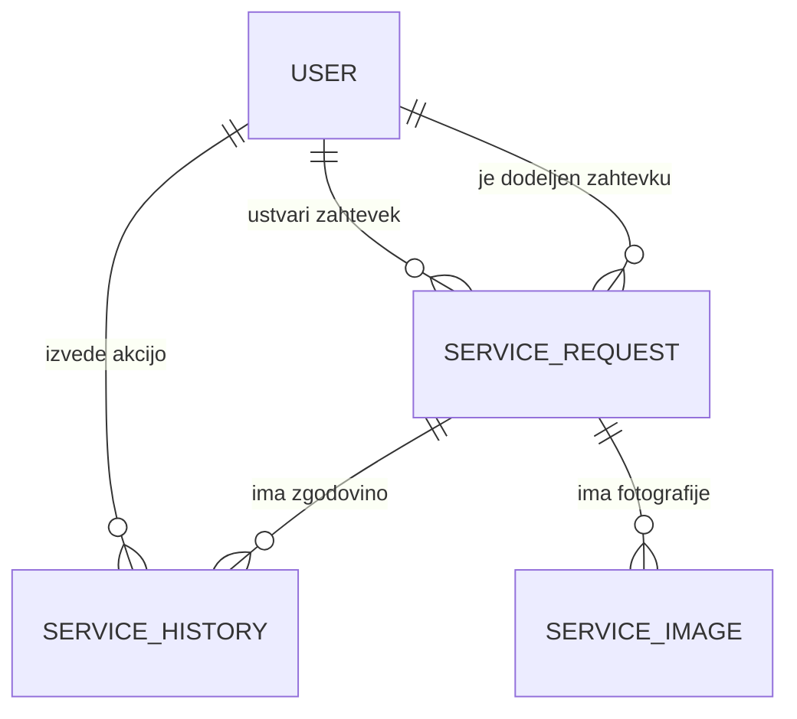

# Podatkovni model

## Entitete

### User

Predstavlja uporabnika sistema.

Glavna polja:

- id
- firstName
- lastName
- email
- passwordHash
- role

Možne vrednosti polja `role`:

- CUSTOMER
- TECHNICIAN
- ADMIN

---

### ServiceRequest

Predstavlja posamezni servisni zahtevek.

Glavna polja:

- id
- title
- description
- applianceType
- brand
- model
- status
- createdAt
- updatedAt
- customerId
- technicianId

Možne vrednosti polja `applianceType`:

- REFRIGERATOR
- WASHING_MACHINE
- DISHWASHER
- DRYER
- OVEN
- FREEZER

Možne vrednosti polja `status`:

- NEW
- ASSIGNED
- IN_PROGRESS
- RESOLVED
- CLOSED

Polje `customerId` določa stranko, ki je zahtevek ustvarila.

Polje `technicianId` določa serviserja, ki mu je zahtevek dodeljen. Na začetku je lahko prazno, dokler mu administrator ne dodeli zahtevka.

---

### ServiceImage

Predstavlja fotografijo, ki je priložena servisnemu zahtevku.

Glavna polja:

- id
- fileName
- filePath
- uploadedAt
- serviceRequestId

Polje `filePath` vsebuje pot do fotografije, ki je fizično shranjena v Docker volume.

Polje `serviceRequestId` določa servisni zahtevek, kateremu fotografija pripada.

---

### ServiceHistory

Predstavlja posamezen korak v zgodovini servisnega zahtevka.

Glavna polja:

- id
- oldStatus
- newStatus
- comment
- createdAt
- serviceRequestId
- userId

Polji `oldStatus` in `newStatus` prikazujeta spremembo stanja servisnega zahtevka.

Polje `comment` lahko vsebuje komentar oziroma opombo, ki jo serviser doda med obravnavo zahtevka. Serviser ga uporablja tudi za zaključni komentar z opisom izvedenega popravila. Administrator lahko komentar doda ob dodelitvi zahtevka serviserju ali ob njegovem dokončnem zaprtju.

Polje `serviceRequestId` določa servisni zahtevek, na katerega se zapis zgodovine nanaša.

Polje `userId` določa uporabnika, ki je izvedel posamezno spremembo.

---

## Povezave med entitetami

- Uporabnik v vlogi stranke lahko ustvari več servisnih zahtevkov.
- Posamezen servisni zahtevek pripada eni stranki.
- En serviser lahko obravnava več servisnih zahtevkov.
- Posamezen servisni zahtevek je lahko dodeljen enemu serviserju.
- Posamezen servisni zahtevek ima lahko več zapisov v zgodovini.
- Posamezen zapis v zgodovini pripada enemu servisnemu zahtevku.
- Posamezen zapis v zgodovini je povezan z uporabnikom, ki je izvedel spremembo.
- Posamezen servisni zahtevek ima lahko več fotografij.
- Posamezna fotografija pripada enemu servisnemu zahtevku.

---

## Osnutek podatkovnega modela

V entiteti `USER` so zajete vse uporabniške vloge: stranka, serviser in administrator. Stranka ustvarja servisne zahtevke, zahtevek je dodeljen posameznemu serviserju (dodeli ga administrator). Akcije uporabnikov, kot so ustvarjanje zahtevka, dodelitev serviserja in spremembe statusa, se beležijo v zgodovino servisnega zahtevka.
