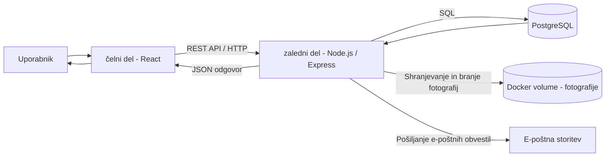

# Arhitektura in tehnološki sklad

## Arhitektura sistema

ServisDesk bo zasnovan kot spletna aplikacija, sestavljena iz treh glavnih delov:

- čelni del,
- zaledni del,
- podatkovna baza.

Čelni del bo uporabniku prikazoval uporabniški vmesnik in omogočal izvajanje funkcionalnosti glede na njegovo uporabniško vlogo.

Zaledni del bo skrbel za poslovno logiko aplikacije, obdelavo zahtevkov, preverjanje uporabniških pravic in komunikacijo s podatkovno bazo.

Podatkovna baza bo namenjena trajnemu shranjevanju uporabnikov, servisnih zahtevkov, podatkov o fotografijah in zgodovine obravnave posameznega zahtevka. Fotografije bodo fizično shranjene v Docker volume, v podatkovni bazi pa bo shranjena pot do posamezne fotografije.

---

## Komunikacija med deli sistema

Čelni del bo z zalednim delom komuniciral preko REST API-ja z uporabo HTTP zahtev.

Zaledni del bo sprejemal zahteve od čelnega dela, izvedel potrebno poslovno logiko ter podatke prebral ali zapisal v podatkovno bazo.

Osnovni potek komunikacije:

1. uporabnik izvede akcijo v spletnem vmesniku,
2. čelni del pošlje HTTP zahtevo zalednemu delu,
3. zaledni del preveri uporabnika in njegove pravice,
4. zaledni del po potrebi dostopa do podatkovne baze,
5. zaledni del vrne odgovor čelnemu delu,
6. čelni del uporabniku prikaže rezultat.

Pri nalaganju fotografij bo čelni del fotografijo poslal zalednemu delu, ki jo bo shranil v Docker volume. Pot do shranjene fotografije bo zapisana v podatkovno bazo in povezana z ustreznim servisnim zahtevkom.

Ob spremembi statusa servisnega zahtevka bo zaledni del sprožil pošiljanje e-poštnega obvestila stranki.

---

## Podatkovna baza

Za shranjevanje podatkov bo uporabljena relacijska podatkovna baza.

V podatkovni bazi bodo shranjene entitete:

- User,
- ServiceRequest,
- ServiceImage,
- ServiceHistory.

Povezave med entitetami bodo izvedene s tujimi ključi.

Na primer:

- `customerId` povezuje servisni zahtevek s stranko,
- `technicianId` povezuje servisni zahtevek z dodeljenim serviserjem,
- `serviceRequestId` povezuje zapis zgodovine s servisnim zahtevkom in povezuje fotografijo s servisnim zahtevkom,
- `userId` povezuje zapis zgodovine z uporabnikom, ki je izvedel posamezno akcijo.

---

## Avtentikacija in upravljanje uporabnikov

Uporabniki se bodo v aplikacijo prijavili z elektronskim naslovom in geslom.

Po uspešni prijavi bo zaledni del uporabniku izdal JWT žeton, ki se bo uporabljal pri nadaljnjih zahtevah do zaščitenih delov aplikacije.

Vsak uporabnik bo imel določeno eno izmed naslednjih vlog:

- CUSTOMER,
- TECHNICIAN,
- ADMIN.

zaledni del bo glede na uporabniško vlogo preverjal, katere funkcionalnosti lahko posamezni uporabnik uporablja.

Na primer:

- stranka lahko dostopa samo do svojih servisnih zahtevkov,
- serviser lahko dostopa do zahtevkov, ki so mu bili dodeljeni,
- administrator ima pregled nad vsemi zahtevki in jih lahko dodeljuje serviserjem.

Gesla uporabnikov bodo v podatkovni bazi shranjena v zgoščeni obliki in ne kot navadno besedilo.

---

## Lokalni zagon

Aplikacija bo med razvojem delovala lokalno z uporabo Docker.

Vsi glavni deli sistema bodo zagnani v ločenih Docker vsebnikih:

- čelni del,
- zaledni del,
- podatkovna baza.

Za skupni zagon in upravljanje vsebnikov bo uporabljen Docker Compose.

Primer lokalnih naslovov:

- čelni del: `http://localhost:5173`
- zaledni del: `http://localhost:3000`
- podatkovna baza: zagnana v ločenem Docker vsebniku

Z uporabo Docker Compose bo mogoče celotno razvojno okolje zagnati z enim ukazom, pri čemer bodo posamezni deli sistema med seboj povezani preko skupnega Docker omrežja.

## Arhitekturni diagram

## Tehnološki sklad

### čelni del

Za razvoj uporabniškega vmesnika bodo uporabljene tehnologije:

- React,
- Vite,
- JavaScript,
- HTML,
- CSS.

React bo uporabljen za izdelavo uporabniškega vmesnika in posameznih komponent aplikacije. Vite bo uporabljen kot razvojno okolje in za pripravo čelnega dela aplikacije.

### zaledni del

Za razvoj strežniškega dela aplikacije bodo uporabljene tehnologije:

- Node.js,
- Express,
- Multer,
- Nodemailer.

Node.js bo uporabljen za izvajanje zalednega dela aplikacije, Express pa za izdelavo REST API-ja in obdelavo HTTP zahtev.

Multer bo uporabljen za obdelavo nalaganja fotografij okvarjenih naprav.

Nodemailer bo uporabljen za pošiljanje e-poštnih obvestil uporabnikom ob spremembi statusa servisnega zahtevka.

### Podatkovna baza

Za trajno shranjevanje podatkov bo uporabljena tehnologija:

- PostgreSQL.

Podatkovna baza bo hranila podatke o uporabnikih, servisnih zahtevkih, podatke o naloženih fotografijah ter zgodovino posameznega zahtevka.

### Avtentikacija

Za prijavo in preverjanje uporabnikov bodo uporabljene tehnologije:

- JWT,
- bcrypt.

JWT bo uporabljen za avtentikacijo in avtorizacijo uporabnikov pri dostopu do zaščitenih funkcionalnosti aplikacije.

bcrypt bo uporabljen za zgoščevanje uporabniških gesel pred shranjevanjem v podatkovno bazo.

### Lokalni razvoj

Za lokalni razvoj in zagon aplikacije bodo uporabljene tehnologije:

- Docker,
- npm.

čelni, zaledni del in podatkovna baza bodo zagnani v ločenih Docker vsebnikih.

Docker Compose bo uporabljen za skupni zagon in upravljanje vseh delov aplikacije.

npm bo uporabljen za upravljanje knjižnic čelnega in zalednega dela aplikacije.

Za trajno shranjevanje naloženih fotografij bo uporabljen Docker volume, ki bo povezan z vsebnikom zalednega dela aplikacije.

## Arhitekturne odločitve

React + Vite -> React omogoča komponentno zasnovo uporabniškega vmesnika in ponovno uporabo komponent, Vite pa omogoča hiter lokalni razvoj in pripravo produkcijske različice aplikacije. Tehnologiji tudi dobro poznam in sem ju že uporabljal pri več projektih.

Node.js + Express -> Node.js omogoča uporabo JavaScripta tudi na backendu, Express pa preprosto izdelavo REST API endpointov in uporabo middleware funkcij. Kombinacijo sem že uporabljal pri izdelavi API-jev.

PostgreSQL -> relacijska podatkovna baza je primerna za podatkovni model aplikacije, ki vsebuje več povezanih entitet, kot so User, ServiceRequest, ServiceHistory in ServiceImage. PostgreSQL omogoča uporabo primarnih in tujih ključev ter zagotavljanje referenčne integritete.

JWT + bcrypt -> JWT bo uporabljen za avtentikacijo uporabnikov in preverjanje uporabniških vlog pri dostopu do posameznih funkcionalnosti. Bcrypt bo uporabljen za varno zgoščevanje gesel pred shranjevanjem v podatkovno bazo.

Docker + Docker Compose -> posamezni deli aplikacije (frontend, backend in PostgreSQL) bodo izvajani v ločenih Docker vsebnikih. Docker Compose bo omogočal enoten in ponovljiv lokalni zagon celotne aplikacije ter konfiguracijo povezav med vsebniki.

Docker volume za shranjevanje fotografij -> fotografije servisnih zahtevkov bodo fizično shranjene v Docker volume, v podatkovni bazi pa bodo shranjeni samo podatki o fotografiji in pot do datoteke.

REST API -> komunikacija med frontend in backend delom aplikacije bo potekala preko REST API-ja z uporabo HTTP zahtevkov. Tak pristop omogoča jasno ločitev uporabniškega vmesnika od poslovne logike ter neodvisen razvoj frontenda in backenda.

Email obveščanje z Nodemailer -> backend bo ob spremembah statusa servisnega zahtevka pošiljal email obvestila uporabnikom. Za pošiljanje bo uporabljen Nodemailer preko SMTP, ker omogoča neposredno integracijo z Node.js backendom.
