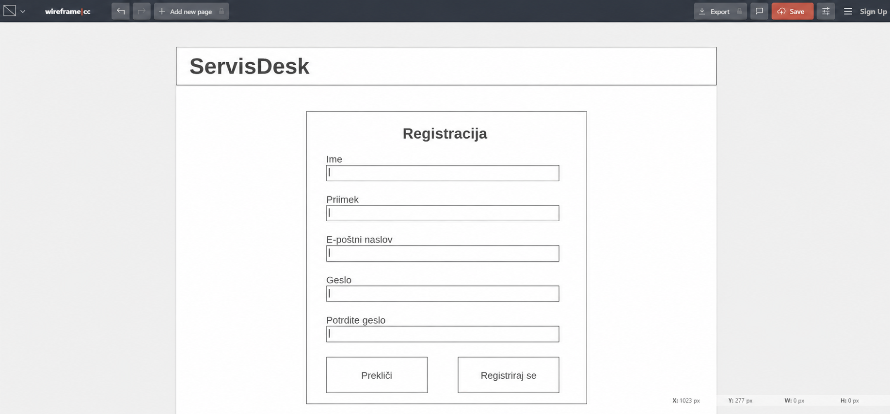
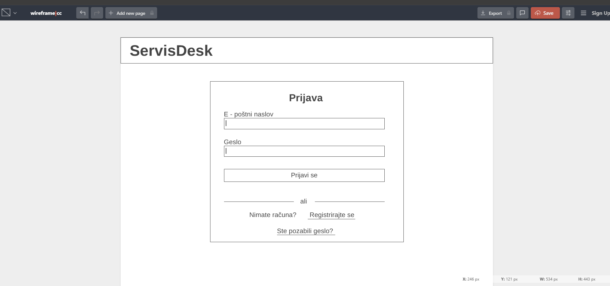
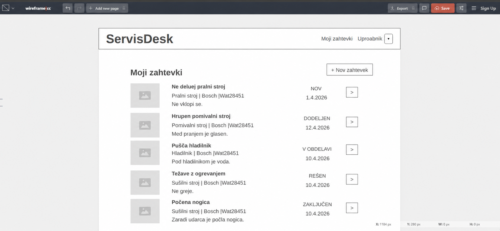
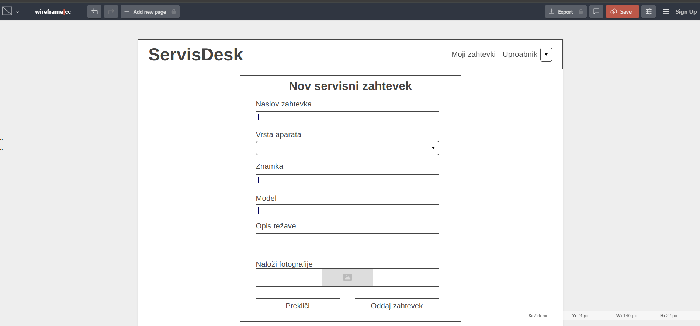
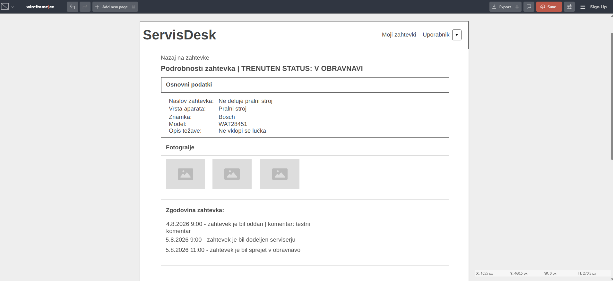
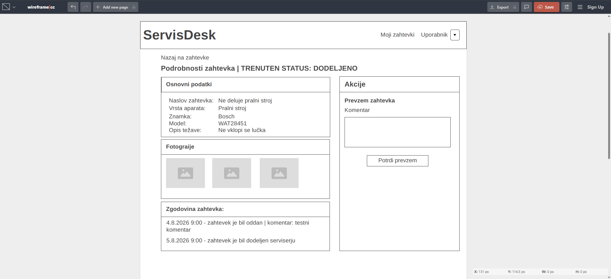
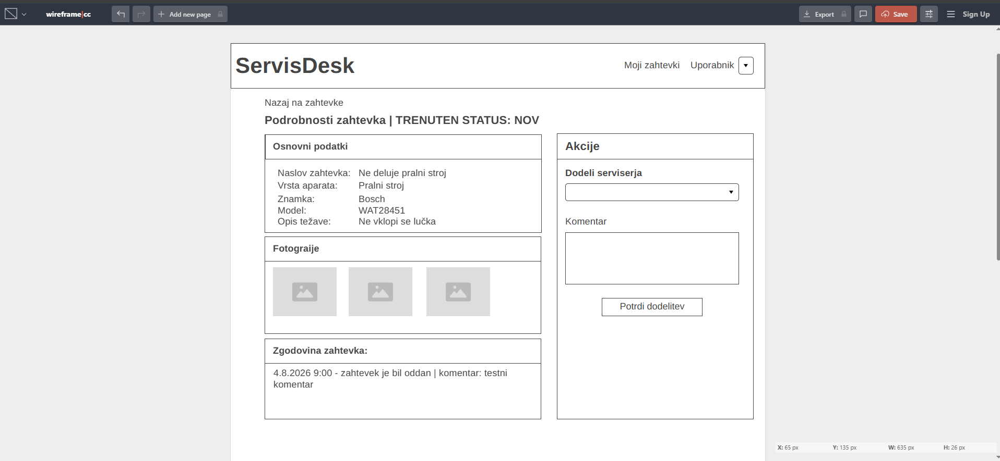

# Wireframes

## WF-01 – Registracija stranke

Wireframe prikazuje stran aplikacije ServisDesk, kjer se lahko stranka registrira z vnosom imena, priimka, elektronskega naslova in gesla.

## WF-02 – Prijava uporabnika

Wireframe prikazuje prijavno stran aplikacije ServisDesk, kjer uporabnik vnese elektronski naslov in geslo za prijavo v sistem.

## WF-03 – Pregled servisnih zahtevkov stranke

Wireframe prikazuje domačo stran stranke s seznamom njenih servisnih zahtevkov, njihovimi statusi in možnostjo ustvarjanja novega zahtevka.

## WF-04 – Ustvarjanje novega servisnega zahtevka

Wireframe prikazuje obrazec za ustvarjanje novega servisnega zahtevka, kjer stranka vnese podatke o napravi, opis težave in lahko priloži fotografije.

## WF-05 – Pregled zahtevka za stranko

Wireframe prikazuje podrobnosti servisnega zahtevka, ki jih vidi stranka, vključno s podatki o napravi, fotografijami, trenutnim statusom in zgodovino zahtevka.

## WF-06 – Pregled zahtevka za serviserja

Wireframe prikazuje podrobnosti dodeljenega servisnega zahtevka za serviserja ter možnosti spreminjanja statusa in dodajanja komentarja.

## WF-07 – Pregled zahtevka za administratorja

Wireframe prikazuje podrobnosti servisnega zahtevka za administratorja, ki lahko zahtevek pregleda, ga dodeli serviserju in doda komentar.
